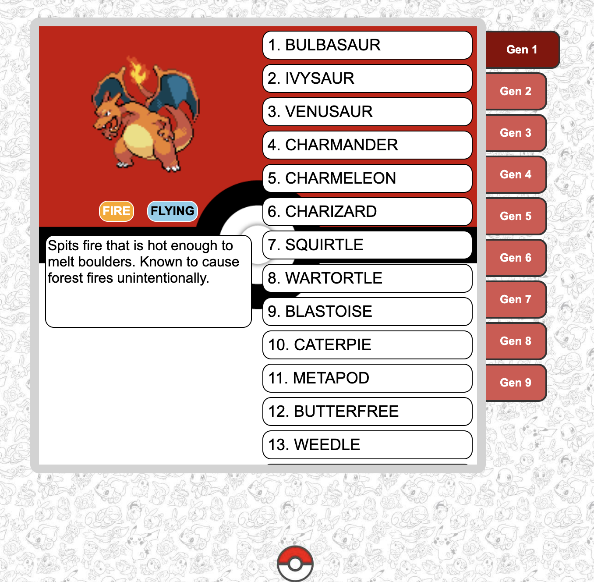

# Pokédex

A simple, interactive Pokédex website built using HTML, CSS, and JavaScript. The application uses the PokéAPI to retrieve Pokémon information across all nine generations.



---

## Features

- Browse Pokémon from Generations 1–9 using binder-style tabs.
- View Pokémon sprites, types, and descriptions.
- Select individual Pokémon to display their information.
- Color-coded Pokémon types.
- Responsive background and interactive interface.
- Pokémon information loads dynamically using PokéAPI.

---

## Tech Used

- HTML5 – Website structure
- CSS3 – Styling and layout
- JavaScript – Interactivity and API requests
- PokéAPI – Pokémon data

---

## How to Run

- Clone or download the repository.
- Open pokedex.html in a web browser.
- Select a generation tab to browse its Pokémon.
- Click a Pokémon to view its information.

--- 

## Project Structure

```bash
pokedex/
├── images/
│   ├── pokemon-bg.jpg
│   ├── pokeball.jpg
│   ├── screenshot.png
│   └── pb-transparent.png
├── pokedex.html
├── pokedex.css
├── pokedex.js
└── README.md
```

---

## Acknowlegements

- Pokémon data and sprites are provided by PokéAPI.
- This is a personal educational project and is not affiliated with or endorsed by Nintendo, Game Freak, or The Pokémon Company.
- Special adaptation from this [YouTube Video](https://youtu.be/dVtnFH4m_fE?si=KFphG8tEEkCDUaY3)
